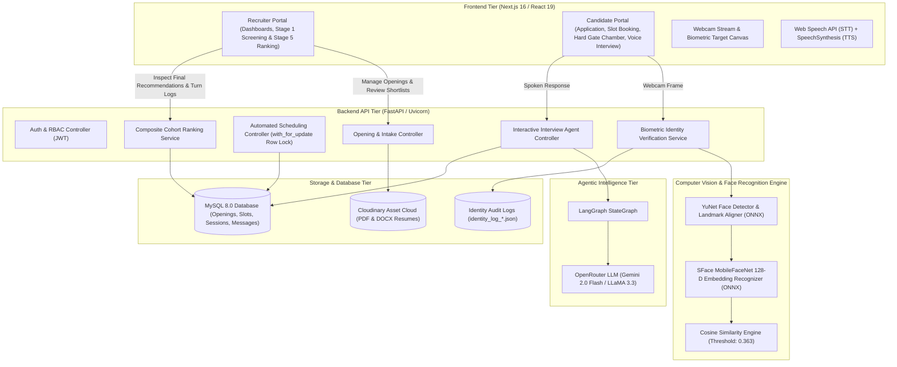
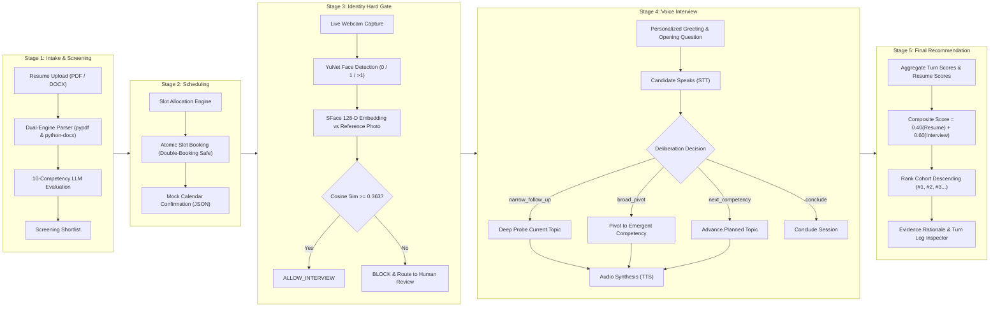
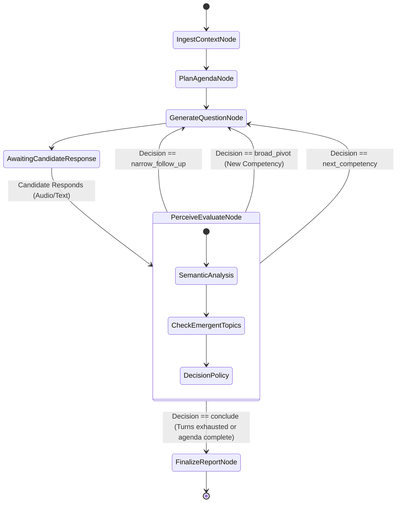

# Project 7: End-to-End AI Hiring Pipeline — Architecture Documentation

**System:** AI-Driven Technical Hiring Pipeline & Autonomous Interview Platform  
**Version:** 2.0 (Production / Capstone Final Delivery)  

---

## 1. High-Level System Architecture

The application is structured into five loosely coupled, highly integrated tiers:
1. **Presentation Tier:** Next.js 16 (React 19 App Router) providing dedicated recruiter and candidate portals with real-time audio/visual capture.
2. **Application Tier:** FastAPI (Python 3.11 ASGI) exposing RESTful endpoints, auth security, and business controllers.
3. **Agent & Intelligence Tier:** LangGraph-driven state-machine agent backed by OpenRouter LLMs for dynamic semantic interview deliberation.
4. **Biometric Computer Vision Tier:** OpenCV Deep Neural Network engine executing **YuNet** (face detection & 5-point landmark alignment) and **SFace** (128-dimensional deep face embedding extraction and cosine similarity verification).
5. **Persistence & Asset Tier:** MySQL 8.0 relational database (InnoDB engine with row-level locking) and Cloudinary raw/secure document storage.



---

## 2. End-to-End 5-Stage Pipeline Workflow



---

## 3. The 10 Predefined Competencies Rubric

Every candidate is evaluated strictly against the following 10 competencies across Stage 1 (Resume) and Stage 4 (Interview):

1. **`technical_depth`:** Core software engineering fundamentals, low-level mechanics, algorithmic rigor, and language mastery.
2. **`system_architecture`:** Distributed systems design, microservices, scaling trade-offs, caching, and database internals.
3. **`problem_solving`:** Edge-case identification, debugging under pressure, root-cause diagnosis, and optimization.
4. **`communication`:** Clarity of thought, structured articulation, active listening, and technical storytelling.
5. **`leadership_mentorship`:** Guiding junior engineers, team leadership, architectural ownership, and knowledge sharing.
6. **`adaptability`:** Navigating unfamiliar technologies, pivoting priorities, and responding to changing production constraints.
7. **`domain_expertise`:** Specialized vertical knowledge (e.g. distributed streaming, machine learning pipelines, cloud infrastructure).
8. **`collaboration`:** Cross-functional partnership, code review etiquette, consensus building, and team alignment.
9. **`analytical_reasoning`:** Data-informed decision making, trade-off quantification, and metric-driven architecture.
10. **`delivery_reliability`:** Production ownership, CI/CD, comprehensive testing rigor, zero-downtime operations, and SLAs.

---

## 4. LangGraph Reasoning Agent State Machine

The reasoning agent maintains an immutable conversational state (`InterviewState`) progressing through the following nodes:



### Turn Reasoning Audit Record Format
For every interaction turn, the agent computes and logs:
```json
{
  "question_num": 2,
  "decision": "broad_pivot",
  "trigger_phrase_from_candidate": "When mentoring junior developers",
  "reasoning": "The candidate shifted from technical caching details to explain how they structured mentorship and code reviews for junior engineers. This surfaces the unassessed leadership_mentorship competency.",
  "question_asked": "Can you describe a specific instance where you mentored a junior engineer through a complex technical problem, and how you balanced guidance with fostering their independent problem-solving skills?",
  "score": 75.0,
  "competency_assessed": "leadership_mentorship"
}
```

---

## 5. Biometric Identity Verification & Hard Gate Architecture

The identity verification pipeline uses deep neural networks running directly inside OpenCV via ONNX runtime:

1. **Face Detection & Alignment:** **YuNet** (`face_detection_yunet_2023mar.onnx`) detects faces and identifies 5 landmark points (eyes, nose, mouth corners).
2. **Face Crop & Affine Normalization:** Cropped and affine-aligned to standard $112 \times 112$ pixels.
3. **Deep Face Embedding:** **SFace** (`face_recognition_sface_2021dec.onnx`) extracts an L2-normalized 128-dimensional embedding vector $\mathbf{v} \in \mathbb{R}^{128}$.
4. **Cosine Similarity Calculation:**
   $$\text{cosine\_similarity}(\mathbf{u}, \mathbf{v}) = \frac{\mathbf{u} \cdot \mathbf{v}}{\|\mathbf{u}\|_2 \|\mathbf{v}\|_2}$$
5. **Decision Policy:**
   - $\text{cosine} \ge 0.363 \implies \mathbf{PASS}$ (Confidence: $0.65 - 1.00$) $\implies$ `ALLOW_INTERVIEW`
   - $0.25 \le \text{cosine} < 0.363 \implies \mathbf{UNCERTAIN}$ (Confidence: $0.50 - 0.64$) $\implies$ `BLOCK_AND_ROUTE_TO_HUMAN_REVIEW`
   - $\text{cosine} < 0.25 \implies \mathbf{FAIL}$ (Confidence: $< 0.50$) $\implies$ `BLOCK_AND_ROUTE_TO_HUMAN_REVIEW`
   - Zero faces or $> 1$ face $\implies \mathbf{FAIL}$ $\implies$ `BLOCK_AND_ROUTE_TO_HUMAN_REVIEW`

---

## 6. Scoring & Cohort Ranking Formulations

$$\text{Composite Score} = (S_{\text{resume}} \times 0.40) + (S_{\text{interview}} \times 0.60)$$

Where:
- $S_{\text{resume}} \in [0, 100]$: Stage 1 score computed across the 10 predefined competencies based on resume evidence.
- $S_{\text{interview}} \in [0, 100]$: Stage 4 score computed as the weighted arithmetic mean of evaluated interview turns.
- **Hiring Recommendations:**
  - $\text{Composite} \ge 70.0 \implies \mathbf{RECOMMENDED}$
  - $55.0 \le \text{Composite} < 70.0 \implies \mathbf{BORDERLINE}$
  - $\text{Composite} < 55.0 \implies \mathbf{REJECTED}$

